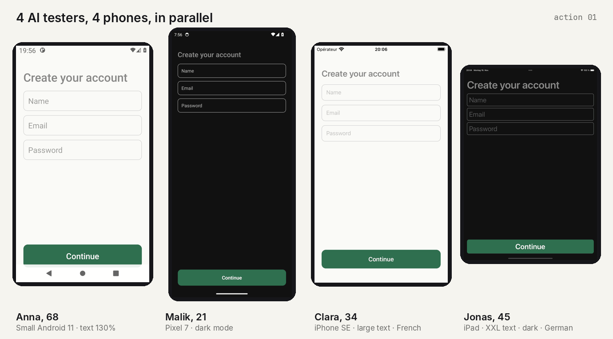
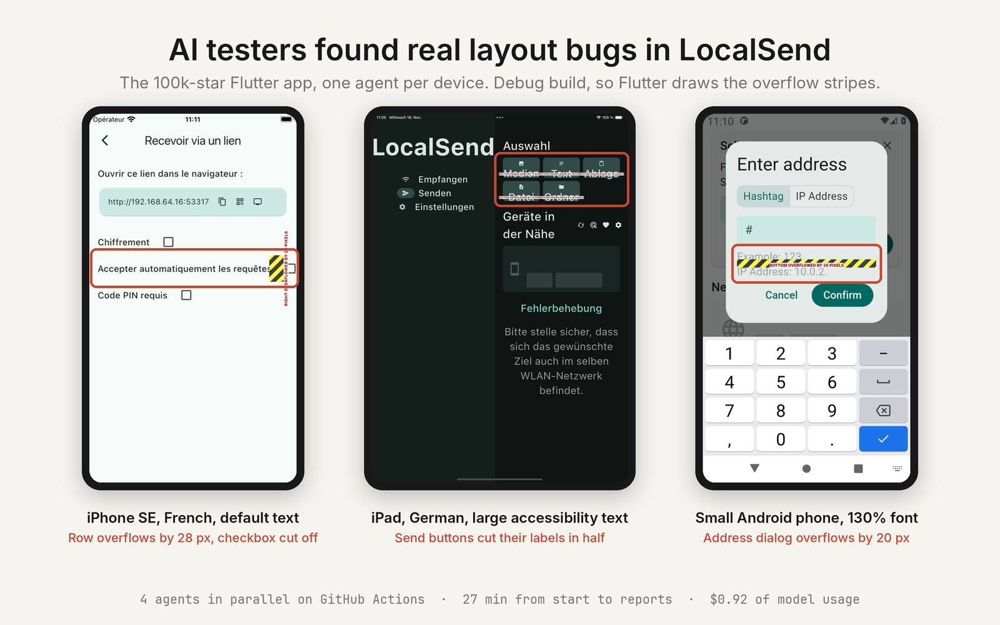

# mobile-agent-testers

**20 AI testers on 20 different phones, in parallel, for $0.**

No test scripts to write. Each tester is a Claude Code agent with its own iOS
Simulator or Android emulator on GitHub Actions. It plays a persona (iPhone SE
in French, Android with 130% text, iPad in dark mode...), uses your app like a
new user and writes a bug report with screenshots. Flutter, React Native, Expo,
native Kotlin and Swift, Kotlin Multiplatform, Capacitor and .NET MAUI.

<p align="center"></p>

[](https://github.com/pierridotite/mobile-agent-testers/stargazers)
[](LICENSE)


[](https://github.com/pierridotite/mobile-agent-testers/commits/main)

## Real findings

<p align="center"></p>

- **[LocalSend](https://github.com/localsend/localsend)** (100k stars, Flutter): one agent per device. On an iPhone SE in French at the default text size, "Recevoir via un lien" overflows by 28 px and hides a checkbox, and the History screen cuts off its "Supprimer l'historique" button. On an iPad with large accessibility text, the Send buttons cut their labels in half and "Hinzufügen" runs off screen. On a small Android phone at 130% text, the address dialog overflows. The Pixel 7 agent got a raw `RsHttpClientError` message after a failed send. 23 issues in all, 27 minutes from start to reports (most of it building the app), $0.92 of model usage.

<p align="center"></p>

- **Flutter's official animations sample** ([flutter/packages](https://github.com/flutter/packages/tree/main/packages/animations/example)): an agent on a Pixel 7 and another on an iPhone SE in French each reported the same typo, "Streamling your courses" ([line 110](https://github.com/flutter/packages/blob/main/packages/animations/example/lib/shared_axis_transition.dart#L110)), and the Android one noticed the app ignores dark mode. 19 minutes, $0.47 of model usage.

Ran it on your app? [Share what it found](https://github.com/pierridotite/mobile-agent-testers/issues/new?title=Finding:%20) and it goes in this list.

## Quick start

```bash
gh repo create my-testers --public --template pierridotite/mobile-agent-testers --clone
cd my-testers && ./setup.sh           # key pair + secrets + Claude token (Windows: .\setup.ps1)
gh workflow run agent-testers.yml     # demo: 2 Android + 2 iOS testers, ~20 min
bash scripts/collect.sh <run id>      # decrypts reports into runs/<id>/SUMMARY.md
```

The demo app has [11 deliberate bugs](demo-app/BUGS.md). On the recorded run above, the 4 demo testers found 9 of them (2 to 7 minutes per agent, about 21 minutes for the whole run, builds included), plus real issues nobody planted (a button under the Android nav bar, no data kept after a relaunch). Model usage: $0.87 for the 4.

Or let Claude set it up for your app:

```
/plugin marketplace add pierridotite/mobile-agent-testers
/plugin install mobile-agent-testers@mobile-agent-testers
```

## Why not Maestro, Appium or agent-device?

They run the tests you write. These agents look for what nobody thought to test.

| | mobile-agent-testers | Maestro, Appium, Detox, e2e |
|---|---|---|
| You write | Nothing: pick personas from the list | Flows or test code |
| It catches | Layout at large text, dark mode, confusing copy, dead ends | What each test checks |
| Same result every run | No: each run explores, so check the screenshots | Yes |

[agent-device](https://github.com/callstackincubator/agent-device) gives one coding agent hands on one simulator. This runs a whole session: it builds the app, gives each persona its own device and collects encrypted reports. Use agents before a release, and scripted flows for regressions.

## Test your own app

```bash
gh workflow run agent-testers.yml -f source_repo=you/app -f app_id=com.you.app \
  -f android_personas=anna,malik -f ios_personas=clara,jonas
```

| Input | |
|---|---|
| `source_repo`, `ref` | App repo and branch (empty = this repo). Private repo: add a read-only `SOURCE_REPO_TOKEN` secret |
| `app_dir`, `app_id` | App folder, Android package / iOS bundle id (if the other platform uses another id, it is read from its built app) |
| `android_personas`, `ios_personas` | Ids from [personas.json](personas.json), one phone each |
| `brief` | Agent instructions ([AGENT_BRIEF.md](AGENT_BRIEF.md)) |
| `framework` | `auto` (default) or force one of the frameworks below |
| `android_build` + `apk_path`, `ios_build` + `ios_app_path` | Your own build command, or a download of a prebuilt app (paths relative to `app_dir`) |
| `block_hosts` | Analytics hosts blocked during tests |
| `record_video` | Screen recording of each phone, encrypted with the reports |

**Supported out of the box** (detected automatically):

| Framework | Android | iOS Simulator |
|---|---|---|
| Flutter | `flutter build apk` | `flutter build ios --simulator` |
| React Native / Expo | Gradle release | Xcode, arm64 |
| Native Kotlin / Java, Swift / Objective-C | Gradle debug | Xcode, arm64 |
| Kotlin Multiplatform | Gradle debug | Xcode project of the iOS app |
| Capacitor / Ionic | Gradle debug after `cap sync` | Xcode after `cap sync` |
| .NET MAUI (beta) | `dotnet publish` | `dotnet build` for `iossimulator-arm64` |
| Anything else | `android_build` + `apk_path` | `ios_build` + `ios_app_path` |

Agents read the screen from screenshots and the accessibility tree, so any UI
toolkit works. Labelled widgets (Flutter `Semantics`, `contentDescription`,
`accessibilityLabel`) give them more precise tap targets.

## How it works

<p align="center"></p>

- **Personas** set the device: model, OS, font size, dark mode, language, location.
- **Three tools per agent**: see the screen (with tap coordinates), gestures, typing.
- **Encrypted results**: public repo logs are public, so everything is encrypted with your key.
- **Analytics blocked** inside the phones, so tests never touch your real stats.

## Limits

- GitHub runners are free for public repos: about 20 jobs at once, 5 on macOS.
- 20 agents can use a Claude subscription's 5-hour window in ~15 min: run batches of 6-10.
- Hosted runners are meant for the repo's own project. For a closed-source app, run the workflow in your private repo or on your own Mac.

## Star history

[](https://star-history.com/#pierridotite/mobile-agent-testers&Date)

## Credits

[Claude Code](https://docs.claude.com/en/docs/claude-code) ·
[AXe](https://github.com/cameroncooke/axe) ·
[android-emulator-runner](https://github.com/ReactiveCircus/android-emulator-runner)

Made by [@pierridotite](https://github.com/pierridotite) ([LinkedIn](https://www.linkedin.com/in/pierre-raffalli/)) · MIT license
