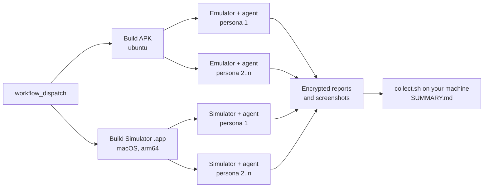

# mobile-agent-testers

**20 AI testers, 20 different phones, at the same time, for $0.**

Each tester is a Claude Code agent with its own iOS Simulator or Android
emulator on GitHub Actions. It plays a persona ("retired teacher, 68, large
text, no patience for jargon"), uses your app like a new user, and writes a
bug report with numbered screenshots, steps to reproduce and a severity. You
get one merged summary at the end.


```
gh workflow run agent-testers.yml        # ~30 min later:
bash scripts/collect.sh <run id>         # runs/<id>/SUMMARY.md + every screenshot
```

## Why

Unit tests don't tell you that the "Continue" button sits under the keyboard
on an iPhone SE, that your header is cut at 130 % font size on a cheap
Android phone, or that a 68-year-old gives up at step 3 of your onboarding.
Real beta testers do, but you rarely have 20 of them before every release.
Hosted AI QA services exist, but they cost money. This repo runs the same
idea on the free runners every public GitHub repo gets.

## Quick start

1. **Create your testers repo** from this template:
   ```bash
   gh repo create my-testers --public --template pierridotite/mobile-agent-testers --clone
   cd my-testers
   ```
2. **Run the setup** (key pair, secrets, Claude token):
   ```bash
   ./setup.sh
   ```
3. **Run the demo**: 2 Android and 2 iOS testers on the bundled Tiny Todo app.
   ```bash
   gh workflow run agent-testers.yml
   ```
4. **Read the reports** on your machine (they are encrypted in the repo):
   ```bash
   bash scripts/collect.sh $(gh run list --workflow agent-testers.yml -L 1 --json databaseId -q '.[0].databaseId')
   ```

Tiny Todo ships with **11 deliberate bugs** ([demo-app/BUGS.md](demo-app/BUGS.md)).
Count how many your agents find before you point them at your own app.

## Use it on your app

Run the same workflow with your app's details:

```bash
gh workflow run agent-testers.yml \
  -f source_repo=you/your-app -f ref=main -f app_dir=. -f app_id=com.you.app \
  -f android_personas=anna,malik -f ios_personas=clara,jonas
```

| Input | Meaning |
|---|---|
| `source_repo` / `ref` | App repo and branch or SHA (empty = the app is in this repo). A private app repo needs a read-only `SOURCE_REPO_TOKEN` secret. |
| `app_dir` | Folder with package.json |
| `app_id` | Android package / iOS bundle id |
| `android_personas` / `ios_personas` | Persona ids from [personas.json](personas.json), one phone each (empty = skip that platform) |
| `brief` | Instructions for the agents ([AGENT_BRIEF.md](AGENT_BRIEF.md)); write a short one for a targeted check |
| `model` | Claude model alias or id |
| `block_hosts` | Analytics and ad hosts the app must not reach during tests |

Builds work out of the box for **Expo** and **bare React Native**. Native
apps and Flutter only need the two build steps changed to produce an `.apk`
and a Simulator `.app`.

## Or let Claude do the setup

The repo is also a Claude Code plugin:

```
/plugin marketplace add pierridotite/mobile-agent-testers
/plugin install mobile-agent-testers@mobile-agent-testers
```

Then ask Claude "set up agent testers for this app" (or run
`/mobile-agent-testers:setup`). It reads your app, fills the inputs, writes
personas for your audience and adapts the brief.

## How it works



- **One phone per persona.** The device is configured from personas.json:
  model, OS version, font size, dark mode, language, GPS position.
- **Three tools per agent, nothing else**: a screen reader (screenshot +
  list of visible elements with tap coordinates), gestures (`adb`, or
  [AXe](https://github.com/cameroncooke/axe) on iOS) and a text typer.
  `--allowedTools` blocks everything else.
- **Screenshot after every action.** The brief requires it. Agents that act
  without looking write wrong bug reports.
- **Everything readable is encrypted** (build logs, apps, screenshots,
  reports) with your public key before upload, because the logs of a public
  repo are public. Only your machine can decrypt.
- **Analytics are blocked** inside the phones (DNS + firewall), and the run
  stops if a blocked host is still reachable, so tests never pollute your
  production stats.

## Personas

Vary what breaks layouts and patience:

```json
{
  "id": "anna",
  "profile": "Retired teacher, 68, low patience with jargon, uses large text.",
  "goal": "Create an account and set up her first item without help.",
  "locale": "en-GB",
  "geo": [51.5072, -0.1276],
  "device": {"name": "Small phone, Android 11", "profile": "Nexus 5", "android_api": 30, "font_scale": 1.3, "theme": "light"}
}
```

iOS personas use `"device": {"simulator": "iPhone SE (3rd generation)", "ios": 18, "text_size": "accessibility-large", "theme": "dark"}`.
A missing model or OS falls back to the closest one available, and the run says so.

## Costs and limits

| | |
|---|---|
| GitHub runners | Free for public repos, macOS included. Free plan: about 20 jobs at once, 5 on macOS (check GitHub's docs, this changes). |
| Claude | A Pro/Max subscription token works (`claude setup-token`), or an API key. Each agent makes 40-100 actions with screenshots. **20 agents at once used a 5-hour subscription window in about 15 minutes**: run batches of 6-10 (`max-parallel` in the workflow). |
| Time | Android build 10-15 min, iOS build 20-30 min, one agent 10-40 min. |

## Fair use

GitHub's terms reserve hosted runners for the software project of the
repository they run in. Testing an open-source app, or the demo app here,
fits. If your app is closed source, the clean options are to run this
workflow inside your private app repo (you pay macOS minutes) or on a
self-hosted Mac.

## Pitfalls already solved

- **iOS keyboard layout**: synthetic key events are US key codes. On an AZERTY
  layout, Cmd+A becomes Cmd+Q and the agent quits your app. The simulator is
  forced to US QWERTY, with autocorrect, auto-capitalisation and predictions off.
- **Accents on iOS** go through the simulator pasteboard, not key by key.
- **Pixels vs points**: iOS screenshots are resized to points, so what the
  agent reads on the image is exactly where it taps.
- **arm64-only Simulator builds**: twice as fast on Apple Silicon runners,
  and no Swift compiler crash on x86_64 slices of some pods.
- **Android language**: the emulator boots in en-US whatever you ask. Root +
  zygote restart applies the persona's locale.
- **KVM, swiftshader, missing device profiles**: handled, with a fallback to Pixel 6.

## Results on a real app

The first 20 runs on one of my production apps (iOS and Android) found,
among others: the keyboard hiding "Continue" on small Android screens, a
search that returned nothing for plurals, and a layout overlapping the
3-button Android navigation bar. Average persona score 6.4/10, no crash.
The most useful part was the comments of the impatient personas.

## Roadmap

- Video of each run (simctl / screenrecord)
- Pull request comment with the merged summary
- Replay a successful path as a Maestro flow
- Flutter and native build presets

Ideas and pull requests welcome.

## Credits

[Claude Code](https://docs.claude.com/en/docs/claude-code),
[AXe](https://github.com/cameroncooke/axe),
[android-emulator-runner](https://github.com/ReactiveCircus/android-emulator-runner).

## License

MIT
