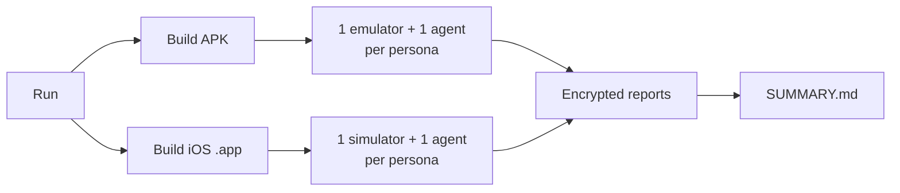

# mobile-agent-testers

**20 AI testers on 20 different phones, in parallel, for $0.**

Each tester is a Claude Code agent with its own iOS Simulator or Android
emulator on GitHub Actions. It plays a persona, uses your app like a new user
and writes a bug report with screenshots. Flutter, React Native, Expo, native
Kotlin and Swift, Kotlin Multiplatform, Capacitor and .NET MAUI.

[](https://github.com/pierridotite/mobile-agent-testers/stargazers)
[](LICENSE)


[](https://github.com/pierridotite/mobile-agent-testers/commits/main)

## Quick start

```bash
gh repo create my-testers --public --template pierridotite/mobile-agent-testers --clone
cd my-testers && ./setup.sh           # key pair + secrets + Claude token
gh workflow run agent-testers.yml     # demo: 2 Android + 2 iOS testers, ~30 min
bash scripts/collect.sh <run id>      # decrypts reports into runs/<id>/SUMMARY.md
```

The demo app has [11 deliberate bugs](demo-app/BUGS.md). See how many the agents find.

Or let Claude set it up for your app:

```
/plugin marketplace add pierridotite/mobile-agent-testers
/plugin install mobile-agent-testers@mobile-agent-testers
```

## Test your own app

```bash
gh workflow run agent-testers.yml -f source_repo=you/app -f app_id=com.you.app \
  -f android_personas=anna,malik -f ios_personas=clara,jonas
```

| Input | |
|---|---|
| `source_repo`, `ref` | App repo and branch (empty = this repo). Private repo: add a read-only `SOURCE_REPO_TOKEN` secret |
| `app_dir`, `app_id` | App folder, Android package / iOS bundle id |
| `android_personas`, `ios_personas` | Ids from [personas.json](personas.json), one phone each |
| `brief` | Agent instructions ([AGENT_BRIEF.md](AGENT_BRIEF.md)) |
| `framework` | `auto` (default) or force one of the frameworks below |
| `android_build` + `apk_path`, `ios_build` + `ios_app_path` | Your own build command, or a download of a prebuilt app (paths relative to `app_dir`) |
| `block_hosts` | Analytics hosts blocked during tests |

**Supported out of the box** (detected automatically):

| Framework | Android | iOS Simulator |
|---|---|---|
| Flutter | `flutter build apk` | `flutter build ios --simulator` |
| React Native / Expo | Gradle release | Xcode, arm64 |
| Native Kotlin / Java, Swift / Objective-C | Gradle debug | Xcode, arm64 |
| Kotlin Multiplatform | Gradle debug | Xcode project of the iOS app |
| Capacitor / Ionic | Gradle debug after `cap sync` | Xcode after `cap sync` |
| .NET MAUI (beta) | `dotnet publish` | `dotnet build` for `iossimulator-arm64` |
| Anything else | `android_build` + `apk_path` | `ios_build` + `ios_app_path` |

Agents read the screen from screenshots and the accessibility tree, so any UI
toolkit works. Labelled widgets (Flutter `Semantics`, `contentDescription`,
`accessibilityLabel`) give them more precise tap targets.

## How it works



- **Personas** set the device: model, OS, font size, dark mode, language, location.
- **Three tools per agent**: see the screen (with tap coordinates), gestures, typing.
- **Encrypted results**: public repo logs are public, so everything is encrypted with your key.
- **Analytics blocked** inside the phones, so tests never touch your real stats.

## Limits

- GitHub runners are free for public repos: about 20 jobs at once, 5 on macOS.
- 20 agents can use a Claude subscription's 5-hour window in ~15 min: run batches of 6-10.
- Hosted runners are meant for the repo's own project. For a closed-source app, run the workflow in your private repo or on your own Mac.

## Star history

[](https://star-history.com/#pierridotite/mobile-agent-testers&Date)

## Credits

[Claude Code](https://docs.claude.com/en/docs/claude-code) ·
[AXe](https://github.com/cameroncooke/axe) ·
[android-emulator-runner](https://github.com/ReactiveCircus/android-emulator-runner)

Made by [@pierridotite](https://github.com/pierridotite) · MIT license
